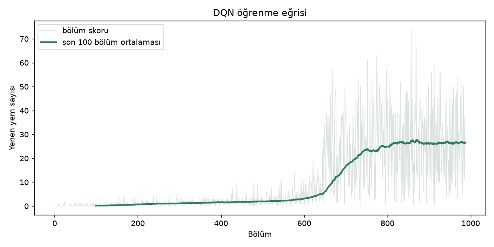
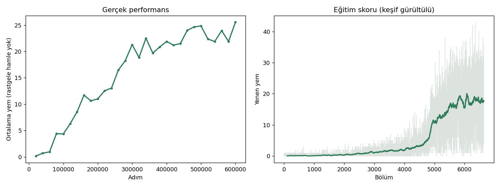

# Kendi kendine öğrenen yılan

Klasik yılan oyununu hem elle oynayabileceğiniz hem de bir yapay zekanın **sıfırdan öğrenerek**
oynamasını izleyebileceğiniz bir pekiştirmeli öğrenme (reinforcement learning) projesi.

Amaç: makine öğrenmesinin gerçekte nasıl çalıştığını görmek. Ajana nasıl oynayacağı söylenmez;
yalnızca ödül (yem +, ölüm −) alır ve deneme-yanılmayla öğrenir.

## Proje bölümleri

| Bölüm | İçerik | Durum |
|---|---|---|
| `web/` | Tarayıcıda çalışan sürüm: tablo tabanlı Q-öğrenme, canlı öğrenme eğrisi | Hazır |
| `bolum1_ozellik_tabanli/` | Python + PyTorch DQN. Ajan, elle tasarlanmış 17 özellik görür | Hazır |
| `bolum2_sifirdan/` | Ham tahta görüntüsünden öğrenme (CNN, Double DQN), Colab GPU'da eğitildi | Hazır |

## Sonuçlar

Rastgele hamle kapalıyken, her model için 200 oyun:

| Yöntem | Ajanın gördüğü | Ortalama yem |
|---|---|---|
| Tablo tabanlı Q-öğrenme (web) | elle seçilmiş 9 bit | ~18 |
| Bölüm 1: DQN, gamma 0.95 | 14 elle tasarlanmış özellik | 57,0 |
| Bölüm 1: DQN, gamma 0.99 | 14 elle tasarlanmış özellik | 65,5 |
| Bölüm 1: DQN, gamma 0.99, 400.000 adım | 14 elle tasarlanmış özellik | 63,0 |
| Bölüm 1: DQN + kuyruğa yol bilgisi (v2) | 17 elle tasarlanmış özellik | **73,4** (ortanca 74, en yüksek 119) |
| **Bölüm 2: CNN DQN, ham tahta** | **3x15x15 görüntü (baş, gövde, yem)** | **23,6** (ortanca 25, en yüksek 42) |

Not: Her satır tek bir eğitimin sonucudur. Eğitimden eğitime birkaç puanlık oynama vardır,
bu yüzden küçük farkları kesin kanıt saymayın.

### Bölüm 1 öğrenme eğrisi


### Bölüm 2 öğrenme eğrisi
Solda rastgele hamlesiz gerçek performans (her 20.000 adımda 20 oyun), sağda eğitim skoru.



## Neler öğrendik

**Bölüm 1**
- Ajan oynamayı gerçekten kendi başına öğreniyor, ama en büyük sıçramalar ona **ne gösterdiğimizden** geldi
  (boş alan, kuyruğa yol, ödül tasarımı), öğrenme algoritmasından değil.
- Gelecek ödüle verilen ağırlık (gamma) 0.95'ten 0.99'a çıkınca sonuç belirgin biçimde iyileşti.
- Eğitimi 2,5 kat uzatmak işe yaramadı: tavan, eğitim süresinden değil ajanın gördüğü bilgiden geliyordu.
- Eğitim grafiğindeki skorlar, rastgele keşif adımları yüzünden gerçek performansın yaklaşık yarısıdır.
  Gerçek gücü `evaluate.py` (rastgele hamle yok) ölçer.

**Bölüm 2**
- Elle yazılmış hiçbir özellik olmadan, yalnızca ham tahtadan bir ajan oynamayı öğrendi ve tabloyu geçti,
  ama Bölüm 1'in elle tasarlanmış özellikli ajanının (73,4) yaklaşık üçte birinde kaldı.
  Ajana ne gösterdiğiniz, öğrenme algoritmasından daha belirleyici.
- Ağ epsilon (rastgele keşif) hâlâ yüksekken öğrenmişti: 160.000. adımda rastgelesiz ölçüm 11,7 iken
  eğitim skoru yaklaşık 3'tü. Eğitim skoruna bakmak performansı olduğundan kötü gösterir.
- Eğitim, Colab T4 GPU'da 600.000 adım için yaklaşık 23 dakika sürdü.
- Eğitim sırasında en iyi çıkan ölçüm 25,6 idi, bağımsız 200 oyunluk ölçüm 23,6 verdi: onlarca ölçümün
  en yükseğini seçmek küçük bir iyimserlik katar.
- Dikkat: Bölüm 2'de "yeme yaklaşma/uzaklaşma" ödülü açıktı, yani ajan tam olarak sıfırdan başlamadı.
  Bu ipucunu kaldırmak (`--sekillendirme-yok`) planlanan bir sonraki deney.

## Kurulum

Python 3.10+ önerilir.

```
pip install -r requirements.txt
```

Windows'ta çok yeni Python sürümlerinde `pygame` derlenemeyebilir, bu yüzden `pygame-ce` kullanılır
(kodda yine `import pygame` yazılır).

## Kullanım

**Bölüm 1**
```
cd bolum1_ozellik_tabanli
python train.py                         # eğit (yaklaşık 10-15 dk), eğri çizer
python evaluate.py model_en_iyi.pt      # rastgele hamlesiz oyunlarla ölç
python play.py                          # 1: insan modu, 2: yapay zeka modu
```

**Bölüm 2**
Eğitim için Colab önerilir: `bolum2_sifirdan/colab_egitim.ipynb` dosyasını Colab'e yükleyin,
çalışma zamanı türünü T4 GPU yapın ve hücreleri sırayla çalıştırın.
Eğitilmiş modeli yerelde izlemek ve ölçmek için:
```
cd bolum2_sifirdan
python evaluate.py model_en_iyi.pt --oyun 200
python play.py
```

## Tarayıcı sürümü

`web/yilan.html` dosyasını tarayıcıda açmanız yeterli. Kurulum gerekmez.

## Planlanan deneyler
- Bölüm 2'yi ödül şekillendirmesi olmadan eğitmek (`--sekillendirme-yok`)
- Gövdeye "yaş" bilgisi vererek (hangi hücre ne zaman boşalacak) ham görüntüyü zenginleştirmek
- Daha uzun eğitim (`--devam`)
